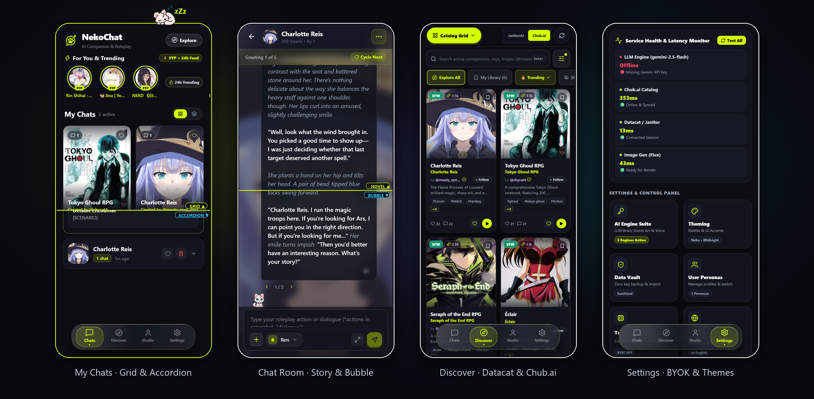
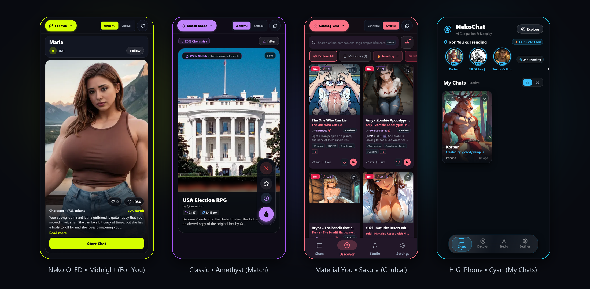

<div align="center">

# 🐾 NekoChat `(v0.2.1 Beta)`

### **Local-First AI Roleplay Client — Zero Login, Zero Remote Chat DB**

*Built with Expo, React Native, and TypeScript. Your chats, memories, character cards, and API keys stay on your device.*  
*(Yes, it's an indie project — built with way too much coffee and a stubborn pixel cat.)*

<p>
  <a href="https://github.com/JustBadThinker/Nekochat/releases/latest">
    
  </a>
  
  
  
  
</p>

<p>
  <a href="#-for-users-beginners">For Users (Download)</a> •
  <a href="#-what-is-byok">What is BYOK?</a> •
  <a href="#-what-nekochat-actually-has">Features</a> •
  <a href="#-for-developers--contributors">For Developers</a> •
  <a href="#-credits--acknowledgements">Credits</a>
</p>

<br />



<br /><br />



</div>

---

## 📱 For Users (Beginners)

Just want to install and chat? You don't need to touch any code.

<p align="left">
  <a href="https://github.com/JustBadThinker/Nekochat/releases/latest">
    
  </a>
</p>

1. **Download & Install** the latest `.apk` from [GitHub Releases](https://github.com/JustBadThinker/Nekochat/releases/latest).
2. **Add an API Key (BYOK)** during onboarding or in **Settings → AI Engine Suite** (Gemini has a free tier; OpenRouter, OpenAI, and local LAN endpoints also work).
3. **Pick a Character** from **Discover** (JanitorAI / Datacat or Chub.ai), import a `.json` / `.png` card, or make your own in **Studio** — then start chatting.

---

## 🔑 What is BYOK?

**BYOK = Bring Your Own Key.** You connect your own API key (Gemini, OpenRouter, OpenAI, or a local model server on your Wi-Fi) instead of paying a NekoChat subscription. *(NekoChat does not bundle free AI credits — you bring your own API key or local endpoint.)*

### Your Data, Your Device. Your AI Provider, Your Choice.

- **Local Storage:** Conversations, memories, character cards, and app settings are stored locally on your device.
- **No NekoChat Account:** NekoChat does not require an account or operate a centralized chat database.
- **Direct AI Connection:** When you send a message, the relevant conversation context is sent directly to your selected AI provider for generation.
- **Provider Privacy:** Data handling, retention, and logging depend on the AI provider's own privacy policy.
- **Secure API Keys:** On native builds, API keys are stored using the device's secure storage (`expo-secure-store`).

NekoChat does not operate a remote chat server. However, using a cloud AI provider means your prompts are transmitted to that provider.

---

## ✨ What NekoChat Actually Has

No buzzwords — here is what's actually built and working today:

### 💬 Chats, Reading & Roleplay
- **My Chats (`ChatsScreen`):** 2-column Bento grid or expandable Accordion list, multi-session support per character, and Timeline Branching (**Branch · Turn N**) to fork stories cleanly without future memory leaking back.
- **Story/Novel & Bubble Modes (`ChatRoomScreen`):** Switch between full-width Novel prose and contained chat bubbles, with configurable dialogue/narration/thought colors and message font presets (`Default`, `Serif`, `Mono`, `Light`).
- **Response Length & Thinking Inspector:** Choose `Standard` (6–9 paragraphs) or `Shorter` (max 5 paragraphs). Tap **Thinking** above an AI reply to view the sanitized prompt and any `<think>` / reasoning tokens emitted by reasoning models.
- **Smart Auto-Darken Wallpapers:** Set a per-chat wallpaper or toggle **Apply background to all chats**. *(Note: on Web, brightness auto-sampling uses a 16×16 canvas and falls back to a 56% dark scrim if a remote image host blocks CORS.)*
- **On-Device Memory & TTS:** Native builds use **SQLite + FTS5/BM25** recall for older rolled-off turns (`AsyncStorage` fallback on Web), manual/auto checkpoints, `[OOC: ...]` mode, and device TTS (`expo-speech`).
- **Desk Neko:** A pixel cat that walks, grooms, and naps on top of the chat input bar — drag/toss her gently or tap her for a quick jump mini-game while waiting for replies.

### 🔍 Discover & Codex
- **Community Catalogs (`DiscoverScreen`):** Browse **JanitorAI (Datacat)** and **Chub.ai** across **Catalog Grid**, **For You**, and **Match Mode** with SFW/NSFW filtering and smart `#tag` search (maps aliases like `#dominance` → `#dominant` and strips literal `#` symbols).
- **Dynamic Cast (`dynamicCastService.ts`):** Detects extra characters from multi-character cards as one-tap `+ Name` chips, and switches RPG/world cards to **Narrator / Game Master** mode.
- **Studio & Codex Lorebooks:** Create or import SillyTavern V1/V2/V3 cards (`.json` / `.png`), manage User Personas, and attach keyword-triggered **Lorebooks** (SillyTavern JSON or JanitorAI static script extractor without `eval()`) to **any** character.
- **In-App Help Center (`HelpCenterModal.tsx`):** Searchable guides inside **Settings → Help & Guides** and **"What is a Lorebook?"** links.

### 🎨 Skins, Themes & Backups
- **4 UI Skins & Dark Palettes:** `Neko OLED`, `Classic`, `Material You`, and `HIG (iPhone)` paired with `Midnight Cyber`, `Sakura Dusk`, `Amethyst`, `Cyber Cyan`, and `Warm Slate`.
- **`.neko` Data Vault & Passcode Lock:** Export/import backups with API keys automatically stripped.

---

## 🛠️ For Developers & Contributors

Want to run NekoChat locally, poke at the code, or open a PR? Welcome!

### Prerequisites
- [Node.js](https://nodejs.org/) `v20+`
- `npm`
- [Expo Go](https://expo.dev/go) on Android/iOS, or an Android/iOS emulator / web browser

### Run Locally
```bash
# 1. Clone and install
git clone https://github.com/JustBadThinker/Nekochat.git
cd Nekochat
npm install

# 2. (Optional, needed for Web CORS / Datacat catalog proxy)
npm run proxy

# 3. Start Expo dev server
npm start
# or directly: npm run android | npm run ios | npm run web
```

### Verify Before Committing
```bash
# Typecheck
npx tsc --noEmit

# Lint
npx expo lint

# Unit & integration tests (Phases 1–6)
node --test tests/phase1-memory-prompt.test.mjs tests/phase2-sqlite-migration.test.mjs tests/phase3-security-privacy.test.mjs tests/phase4-bm25-retrieval.test.mjs tests/phase5-memory-lifecycle.test.mjs tests/phase6-chat-branching.test.mjs
```

### Project Map (Where Things Live)
| Folder | What's Inside |
| :--- | :--- |
| `src/screens/` | Main screens (`ChatsScreen`, `DiscoverScreen`, `ChatRoomScreen`, `UserStudioScreen`, `SettingsScreen`) |
| `src/components/chat/` | Extracted chat room modules (like `ChatBackgroundLayer.tsx`) |
| `src/components/` | Shared UI (`BottomSheetModal`, `HelpCenterModal`, `CapsuleDock`, `DeskNekoWalker`, `TinderDeck`, etc.) |
| `src/services/` | Storage (`SQLite` + `AsyncStorage`), AI providers, Lorebooks, Dynamic Cast, Prompt Budget, Vault |
| `src/theme/` | UI Skins (`neko`, `classic`, `material`, `hig`) and color palettes |
| `server.mjs` | Optional stateless local proxy on port `3001` for Web CORS & Datacat catalog requests |

---

## 🙏 Credits & Acknowledgements

NekoChat wouldn't exist without these open-source tools and community specs:
- **[Expo](https://expo.dev/) & [React Native](https://reactnative.dev/)** (`expo-sqlite`, `expo-secure-store`, `expo-blur`, `expo-linear-gradient`, `expo-speech`, `expo-file-system`, `expo-image-picker`, `expo-document-picker`)
- **[Lucide Icons (`lucide-react-native`)](https://lucide.dev/)** for crisp icons across every screen
- **[CryptoJS](https://github.com/brix/crypto-js)** for client-side Data Vault encryption helpers
- **Community Character Card Specs:** SillyTavern Character Card V1 / V2 / V3 (`chara` / `ccv3` PNG metadata & JSON) and Lorebook V2 format
- **Community Catalogs:** [Chub.ai](https://chub.ai/) and Datacat / JanitorAI public character ecosystems

---

## 🤝 Contributing & License

Pull requests, bug reports, UI polish, and translations are always welcome!  
Check [CONTRIBUTING.md](CONTRIBUTING.md) and our [PR template](.github/pull_request_template.md) before opening a PR.

Licensed under the **MIT License with Attribution** — see [LICENSE](LICENSE) for details.
